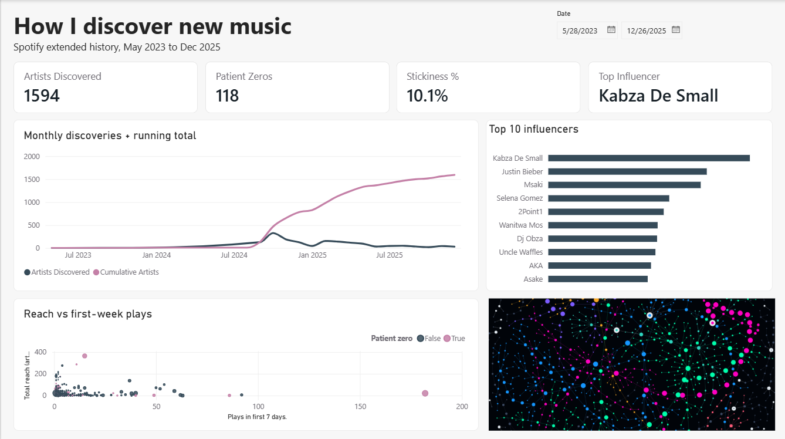

# Infection Lab

**How did I actually discover my music?** Infection Lab turns your Spotify extended
streaming history into a discovery map: every artist's first play is an "infection",
and its source is whatever you were listening to just before.



**[Live demo (synthetic data)](https://alistairmazhambe.github.io/infection-lab/)** |
[Power BI build guide](powerbi/POWERBI_GUIDE.md)


## What it does

- Reads your Spotify *Extended streaming history* export (the `Streaming_History_Audio_*.json` files).
- Keeps real listens (30 seconds or more by default) and finds the first time you heard each artist.
- Links each new artist to the artist you were playing right before it, if that was within 2 hours.
  This gives every artist at most one parent, so the result is a forest of discovery trees.
- Writes a self-contained interactive HTML map (search, patient-zero list, per-artist dossier).
- Optionally exports flat CSVs for Power BI or Excel.

## Metrics

| Metric | Meaning |
|---|---|
| **Patient zero** | An artist with no source in the window: a spontaneous find |
| **Direct infections** | Artists whose first play directly followed this one |
| **Total reach** | All artists downstream of this one in the discovery tree |
| **Plays in first 7 days** | This artist's own plays in the week after you first heard them |
| **Stickiness** | Share of artists with 5 or more plays in that first week (the threshold is adjustable) |

## Quick start

```bash
git clone https://github.com/AlistairMazhambe/infection-lab.git
cd infection-lab
pip install -r requirements.txt

python infection_lab.py --demo                  # try it with synthetic data
python infection_lab.py --data path/to/history  # run it on your own export
python infection_lab.py --data path/to/history --csv   # also write CSVs for Power BI
```

Get your data at spotify.com/account/privacy (request *Extended streaming history*;
delivery can take several days).

### Options

| Flag | Default | Description |
|---|---|---|
| `--data` | `.` | Folder containing `Streaming_History_Audio_*.json` |
| `--out` | `infection_lab.html` | Output HTML file |
| `--window` | `2.0` | Hours before a first play to look for a source |
| `--min-ms` | `30000` | Ignore plays shorter than this |
| `--demo` | off | Use synthetic data |
| `--csv` | off | Also write `*_nodes.csv` and `*_edges.csv` |
| `--no-open` | off | Do not open the browser |

## Power BI dashboard

The CSV export feeds a Power BI report with discoveries per month, top influencers,
and reach vs first-week plays. The theme, DAX measures and layout are in
[`powerbi/`](powerbi/POWERBI_GUIDE.md), with sample CSVs to practise on.

## Design notes and limits

- **Reach is sequence, not causation.** It shows what came after what, not what made you
  listen. It also favours being early in long listening sessions.
- The source is the play immediately before a first listen, so autoplay and shuffle
  produce links that were not your choice.
- Spotify's `ts` marks when a play *ended*; the script subtracts `ms_played` to get the start.
- Artists with no source and no children are left off the map (they are still searchable).
- Podcasts and videos are ignored.

## Privacy

Your export contains personal data (including IP addresses in some files).
`.gitignore` keeps raw exports and generated files out of the repo. Everything runs
locally; the generated page only loads vis-network and a font from public CDNs.

## Built with

Python (pandas, NetworkX, NumPy), vis-network, Power BI.

## License

MIT. See [LICENSE](LICENSE).
